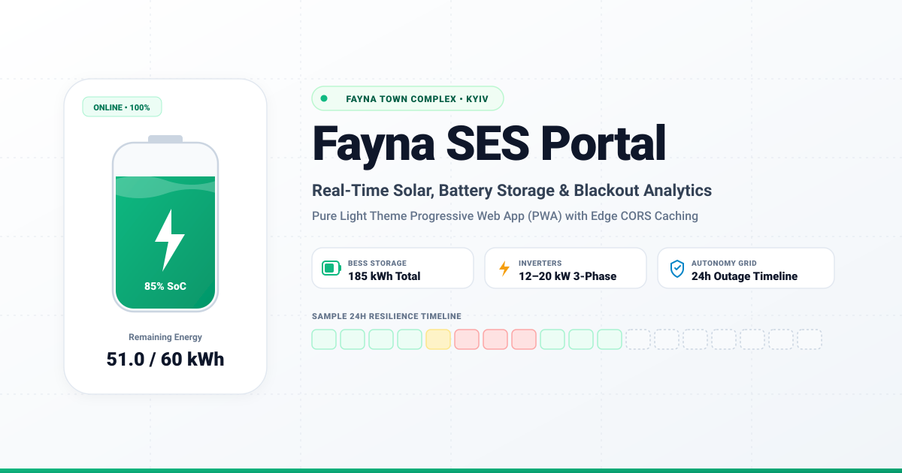

# ☀️ Fayna SES Portal



> **Modern Progressive Web App (PWA)** for real-time monitoring of battery storage, solar generation (SES), and building autonomy during power grid outages in the **Fayna Town** residential complex (Kyiv).

[](https://fayna-ses-cq2.pages.dev)
[](https://vuejs.org/)
[](https://www.typescriptlang.org/)
[](https://cloudflare.com)
[](https://web.dev/progressive-web-apps/)
[](https://opensource.org/licenses/MIT)

---

## ⚡ Features

* **☀️ Pure Light Theme UI**:
  * Clean, high-contrast, modern light aesthetic designed for effortless readability under any lighting condition.
  * Delicate custom scrollbars configured with inset track margins to never interfere with rounded container corners.
  * Crisp light portal icon and favicon.
* **📱 Universal PWA Installation**:
  * One-click installation on Desktop (Chrome, Edge, Brave) and Android via native `beforeinstallprompt`.
  * Contextual step-by-step installation modal for iOS Safari ("Share" $\to$ "Add to Home Screen") and unsupported desktop browsers.
  * Instant offline loading backed by Workbox Service Worker caching.
* **🔋 Liquid Battery Gauge & Dynamic Autonomy**:
  * Fluid animated liquid wave visualization reflecting real-time charging and discharging states.
  * Accurate autonomy forecast based on current battery capacity, remaining stored energy, and load demand.
* **📊 Outage Analytics & Blackout Timeline**:
  * **24-Hour Timeline Grid**:
    * 🟢 **Power ON (`220V`)**: Normal grid operation (< 15 min outage).
    * 🟡 **Partial Outage (`½ BATT` / `½ АКБ`)**: 15–45 minutes of outage represented by a split half-fill vertical gradient.
    * 🔴 **Full Blackout (`BATT` / `АКБ`)**: Outage duration > 45 minutes sustained by backup battery storage.
    * ⚪ **Upcoming (`—`)**: Light styled future hours yet to occur in the current day.
  * **Monthly Outage Dynamic**: Chart.js bar graph tracking battery backup energy supplied during grid disconnections.
* **⚡ Station Hardware Specs & Real-Time Inverter Load**:
  * Inverter power rating (e.g., `12 kW`, `15 kW`, `20 kW`).
  * Real-time inverter load percentage (`%`).
  * Remaining stored energy in kWh vs. full capacity.
  * Daily peak load tracking.
* **🌍 Full Localization (i18n)**:
  * Seamless Ukrainian (UA) and English (EN) translation.
  * Automatic browser language detection (`navigator.language`).
  * Dynamic localization of measurement units (`kWh` ⇄ `кВт·г`, `kW` ⇄ `кВт`, `W` ⇄ `Вт`), building names, and descriptions.
* **🛡️ Edge Proxy & CORS Bypass**:
  * Cloudflare Pages Functions proxy (`/api/...`) that bypasses upstream CORS restrictions.
  * Edge caching (`s-maxage=60, stale-while-revalidate=300`) shielding upstream `data-ses.funs.net.ua` from high-load traffic during mass blackouts.
* **🔔 Zero-Cost Web Push Notifications (PWA)**:
  * Full RFC 8291 WebCrypto encryption (`aes128gcm`) running directly on Cloudflare Edge without third-party services (Firebase/OneSignal).
  * Automated 2-minute Cron outage detector paired with Cloudflare D1 state persistence.
  * Native iOS Apple APNs collapsing (`apns-collapse-id: fayna-grid-status`) & `renotify: false` ensuring non-intrusive in-place updates.
* **🎯 Zero-CLS Layout Stability**:
  * Static skeleton cards pre-rendered on mount with identical pixel geometry (`min-h-[92px]`, `h-[20px]`, `tabular-nums`, `whitespace-nowrap`).
  * Pure native scroll persistence eliminating header/footer jumps on refresh and deep links.

---

## 🏗️ Tech Stack

* **Frontend Framework**: [Vue 3](https://vuejs.org/) (Composition API with `<script setup>`), [TypeScript](https://www.typescriptlang.org/).
* **Styling**: [TailwindCSS](https://tailwindcss.com/) with pure light theme design, [Lucide Icons](https://lucide.dev/).
* **Data Visualization**: [Chart.js](https://www.chartjs.org/) with selective tree-shaking for minimal bundle footprint.
* **PWA & Offline**: `vite-plugin-pwa`, Workbox.
* **Edge Backend**: [Cloudflare Pages Functions](https://developers.cloudflare.com/pages/functions/), Cloudflare Workers, Cloudflare Cache API.

---

## 🚀 Quick Start (Local Development)

```bash
# Clone repository
git clone https://github.com/babych/fayna-ses-portal.git
cd fayna-ses-portal

# Install dependencies
npm install

# Start local Vite development server
npm run dev
```

---

## ☁️ Deployment

### 1. Build and Test
```bash
npm run build
```

### 2. Deploy to Cloudflare Pages via Wrangler CLI
```bash
# Deploy production build
npx wrangler pages deploy dist --project-name=fayna-ses --commit-dirty=true --branch=main
```

---

## 📄 License

MIT © [Dmytro Babych](https://github.com/babych)  
Telemetry data is provided by the Fayna Town SES infrastructure and inspired by [ha-fayna-ses](https://github.com/denysdovhan/ha-fayna-ses).
